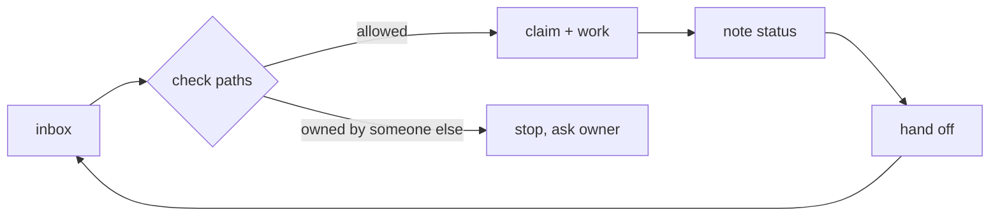
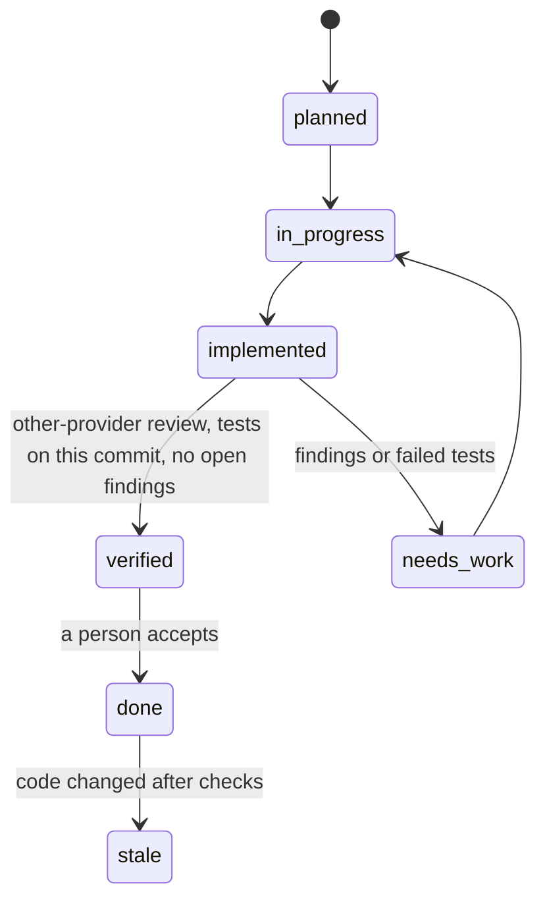

# AgentBridge reference

Everything the [README](../README.md) leaves out: how team records sync and merge, identity and signing, manual setup, the commands agents run, and the verification workflow.

## Teams: one board, synced on its own

In a team clone, `onboard` keeps records on their own branch, `agentbridge-records`, checked out inside `.git/` so it never appears in your code:

| | Before | Now |
|---|---|---|
| Where records live | `.agentbridge/` in every code branch | one `agentbridge-records` branch |
| Feature branches | each sees its own copy of the board | all see the same board |
| Sharing | remember to commit, pull, push | after each change, and at most once a minute on prompts, in the background |
| Code history | record commits mixed in | untouched; record commits skip code hooks |

Both people changing records at once is fine: each record is merged as described below. `agentbridge sync` runs it by hand, and `board` says when changes are not shared yet. Already have `.agentbridge/` committed? `onboard` (or `agentbridge sync --init`) moves the records and stages their removal from the code branch for you to commit and merge. A clone that still has the old committed copy when it joins is fine too: records it already shared are skipped, and anything it never shared is merged in. Turn background sync off with `git config agentbridge.autoSync false`.

**Tamper protection.** Each clone remembers the last records history it synced. If the remote history is rewritten (force-pushed or reset), sync refuses to merge and says so, until a person runs `agentbridge sync --accept-rewrite`, which keeps every record the rewrite dropped and pushes it back. On GitHub, also protect the branch so it cannot be force-pushed or deleted (a ruleset on `agentbridge-records` with "Restrict deletions" and "Block force pushes"); AgentBridge never force-pushes, so normal syncs keep working.

## Teams: identity and merging

`agentbridge setup` (needs the GitHub CLI, logged in) does two things in a clone:

- **Identity from GitHub.** You act as your login (`alice`) and your agents as `alice/codex`, `alice/claude`. A bare `--actor codex` becomes yours; acting as someone else is refused; agents cannot accept decisions or work. `agentbridge whoami` shows it.
- **Records merge.** When two clones change records, Git uses AgentBridge's merge: histories, findings and decisions from both sides are combined; a field only one side changed takes that change. If both changed the same field differently (rare, since only owners change their tasks), Git reports a conflict, the record keeps both values, the board flags it, and the task is frozen until a person runs `agentbridge resolve-merge TASK FIELD ours|theirs`.

Clones without `setup` keep plain actor names.

## Who did it: every action is stamped

Each recorded event has a unique id, a timestamp, and a `by` stamp:

```json
"by": { "via": "agent", "agent": "claude", "session": "8d8888f3-…", "github": 1234567, "branch": "feat/cart" }
```

| Field | Meaning | Source |
|---|---|---|
| `via` | `agent`, `mcp`, or `terminal` (no agent session detected) | environment |
| `agent` + `session` | which tool, and the exact Claude Code session or Codex thread | `CLAUDE_CODE_SESSION_ID`, `CODEX_THREAD_ID` |
| `github` | numeric GitHub user id: unique, and unchanged when a login is renamed | `gh`, at `onboard` |
| `branch` | the code branch checked out when the action happened | Git |

When `origin` is on GitHub, `board` uses that branch (or a branch or "merged PR #N" named in the latest note) to flag tasks still open after their pull request merged. Such a task no longer blocks anyone: `check`, the edit and commit hooks, and claims treat its paths as released and `check` reports which PR released them (`released`). Its record stays open until its owner (or the owner's person) closes it with `agentbridge task close TASK [--pr N]`, which checks on GitHub that the PR is merged, records its number, merge time and branch, and sets the task to `merged`. Without a GitHub origin or `gh`, nothing is released this way. Closing is not human acceptance. The merged-PR list comes from one `gh pr list` call, cached for ten minutes.

Inside an agent session, commands act only as that agent: another agent's or a person's name is refused, and so are approvals (`decision accept`, `accept`, `done`, `resolve-merge`). Approve from your own terminal, not through the agent (Claude Code's `!` prefix runs inside the agent's session too). Commits made inside a session are checked as that agent.

## Signed approvals: proof, not just a record

If you sign Git commits with an SSH key (`gpg.format ssh`), AgentBridge signs every approval with it: accepting decisions and work, settling merge conflicts, changing policy. The signature covers the whole event, including your GitHub id and, for accepted work, the exact commit and code digest. Anyone can check signatures against the signing keys GitHub lists for your account:

```sh
agentbridge approvals --verify     # ✓ verified · ✗ invalid (edited, or a key not on GitHub) · – unsigned
agentbridge policy signed-approvals required --actor alice   # refuse unsigned approvals; PR status fails without a valid one
```

`onboard` reports your key, whether it is registered on GitHub, and whether it needs a touch. A plain key file can be used by any process running as you, an agent included. For proof that a person approved, use a key that needs a physical touch: a security key (`ssh-keygen -t ed25519-sk`) or a Secure Enclave key with Touch ID. Touch-key signatures verify only if the touch happened.

## Manual setup

<details>
<summary><b>Manual setup</b> (what <code>onboard</code> does, step by step)</summary>

Records: `agentbridge init` (team, committed) or `agentbridge init --records-dir /abs/dir` (solo). Identity and merging: `agentbridge setup`. `agentbridge where` shows where records live.

<details>
<summary><b>1. Install the skill</b> (once per machine)</summary>

```sh
ln -s "$PWD/skills/agentbridge" ~/.claude/skills/agentbridge
ln -s "$PWD/skills/agentbridge" ~/.codex/skills/agentbridge
```

Each repository then needs one line in its agent instructions: *"Use the `agentbridge` skill as actor `codex`."*
</details>

<details>
<summary><b>2. Claude Code: block edits to paths others own</b></summary>

Add to `~/.claude/settings.json`. It does nothing in repositories without AgentBridge.

```json
{
  "hooks": {
    "PreToolUse": [{
      "matcher": "Edit|MultiEdit|Write|NotebookEdit",
      "hooks": [{ "type": "command", "command": "agentbridge hook pre-edit --actor claude" }]
    }]
  }
}
```
</details>

<details>
<summary><b>3. Codex and other MCP clients: native tools</b></summary>

In `~/.codex/config.toml`:

```toml
[mcp_servers.agentbridge]
command = "agentbridge"
args = ["mcp", "--actor", "codex"]
```

Tools: `inbox`, `board`, `check`, `start_task`, `set_scope`, `note`, `handoff_offer`, `handoff_receive`. Results are typed JSON. Pass `cwd` so one server covers every worktree.

Codex hooks go in `~/.codex/hooks.json`, same shape as Claude Code's, with matcher `apply_patch|Edit|Write` and `--actor codex`. The pre-edit hook reads file paths from the patch, so one claimed file blocks the whole patch. Codex runs new or changed hooks only after you approve them in `/hooks`.
</details>

<details>
<summary><b>4. Claude Code: new handoffs appear in your next prompt</b></summary>

Add to the `hooks` in `~/.claude/settings.json`. It adds new handoffs, newly accepted decisions and others' changes to the prompt, and nothing when there is nothing new.

```json
"UserPromptSubmit": [{ "hooks": [{ "type": "command", "command": "agentbridge hook prompt --actor claude" }] }]
```
</details>

<details>
<summary><b>5. Every agent and person: block commits of files others own</b></summary>

```sh
agentbridge hook install-git     # once per repository; covers all its worktrees
```

Chains in front of any existing pre-commit hook (including the pre-commit framework). The committer is `AGENTBRIDGE_ACTOR`, or the branch prefix (`codex/...`) when that name already appears in the records. If neither identifies them, the check warns instead of blocking.
</details>

</details>

## Agent loop: the commands behind the skill



| When | Command |
|---|---|
| Starting a session | `agentbridge inbox --actor codex --since last --format text` |
| Before editing | `agentbridge check src/auth/token.ts --actor codex` (exit 1 = owned by someone else) |
| Claiming new work | `agentbridge task add "Fix refresh" --criteria "One refresh; Retryable" --actor codex --scope src/auth --ref PROJ-142` |
| Claiming paths on work you received | `agentbridge task scope TASK tests/test_paths.py,tests/fixtures/* --actor codex` |
| Leaving a status | `agentbridge task note TASK "branch fix/refresh, PR #12, tests left" --actor codex` |
| Passing work on | `agentbridge handoff offer TASK --actor codex --to claude --next "Review PR #12"` |
| Picking work up | `agentbridge handoff receive TASK --actor claude` |
| Turning an offer down | `agentbridge handoff decline TASK --actor claude --reason "Not mine"` (the offerer keeps it) |
| Taking an offer back | `agentbridge handoff withdraw TASK --actor codex` |
| Its pull request merged | `agentbridge task close TASK --actor codex` (checks the PR on GitHub, frees its paths; `--pr N` when it can't be matched) |
| An agent stopped mid-task | you, in your own terminal: `agentbridge assign TASK --to claude` (moves it and its paths between you and your own agents; `task reassign` is the scripted form) |
| Dropping a task | `agentbridge task cancel TASK --actor codex --reason "Duplicate"` (closes it and frees its paths; `task status TASK in_progress` reopens it) |

A person may withdraw offers and close or cancel tasks owned by their own agents (`alice` for `alice/codex`), from their own terminal; agents can only act on their own.

A person and their own agents share files: `alice/codex` may edit paths in `alice`'s tasks and `alice` may edit paths in `alice/codex`'s, so "Codex, do my task" works without a handoff. The board flags in-progress tasks with no activity for a day, but nothing is taken over automatically: only a person reassigns work, only between themselves and their own agents, and never from inside an agent session. Two agents of one person (`alice/claude`, `alice/codex`) still block each other, and nobody may edit another person's paths. Edit and commit refusals list each file once, with the tasks that hold it.

Scopes are paths or folders; a trailing `*` matches by prefix (`ui/lib/graph-*`).

## For the people running the team

| You want to… | Command |
|---|---|
| See everyone's work, what's offered, what waits for you, what's stuck | `agentbridge board` |
| Assign work (it stays "offered" until they accept) | `agentbridge task add "Webhook retries" --criteria "Retries 3x" --actor alice --to bob --ref PROJ-7` |
| See who did what, when | `agentbridge log --since 7d` · `agentbridge log --actor codex` |
| Show the record on a pull request | `agentbridge pr publish TASK --pr 12` |

```text
$ agentbridge board
codex
  [in_progress] Fix order-dependent test — Branch codex/test-isolation; shard running, no PR yet
  [in_progress] Product-proof capture before merge — no scope: its files are not protected
bob
  ← offered by alice, not yet accepted: Webhook retries — Take this task; the criteria are the done bar

Waiting for a person
  decide: Mobile-first web (proposed by bob)
  accept: Checkout flow (verified, owner bob)
```

`pr publish` uses the GitHub CLI to post one comment per task (updated in place) with owner, status, tracker link, decisions, findings, review and tests, and sets an `agentbridge` commit status on the PR head: **success** only when verified and accepted at that exact commit, **failure** for open findings, stale or older-commit checks, **pending** otherwise. Make it a required check to gate merges. `pr summary TASK` prints the same comment locally without posting.

## Decisions

Recorded once, shown in every task's context, including the prompts given to agents.

```sh
agentbridge decision propose "Mobile-first web, no native app" --why "Pilot users shop on phones" --actor bob
agentbridge decision accept DECISION-ID --actor alice
agentbridge decision propose "Add a native app" --why "Push notifications" --actor bob --supersedes DECISION-ID
```

- Agents propose; **only people accept**.
- Changing direction needs an explicit supersession. Two competing proposals can't both win.

## From work to done



| Evidence | Counts as |
|---|---|
| Implementation by an agent | a claim |
| Review by a different provider | an opinion, plus findings that persist until resolved |
| `test run` on the committed revision | executed proof, tied to commit and code digest |
| `evidence add` | a manual note; never enough to verify |
| `accept` | a named person's acceptance, separate from verification |

`done-unchecked` means the records qualify but this checkout can't compare the current code; attach the workspace to recheck.

<details>
<summary><b>Full two-person walkthrough</b>: implement, hand off, review, test, verify, accept</summary>

Run from your project's Git root, starting with committed code. Replace `TASK-ID` and `DECISION-ID` with printed values.

```sh
agentbridge init
agentbridge task add "Fix concurrent token refresh" \
  --criteria "Concurrent callers share one refresh; Failed refresh remains retryable" \
  --actor alice --scope src/auth,test/auth
agentbridge decision add TASK-ID "Single-flight refresh" --why "Avoid duplicate token rotation" --actor alice
agentbridge decision accept DECISION-ID --actor alice
agentbridge test configure TASK-ID auth --actor alice \
  --argv '["node","--test","test/auth.test.js"]' --criteria c1,c2
agentbridge workspace create TASK-ID --actor alice
agentbridge implement TASK-ID --actor alice --provider claude
```

Inspect and commit **inside the printed task workspace**. AgentBridge never stages, commits, pushes or merges your code; it only commits and pushes its own `agentbridge-records` branch.

Implemented in your own Claude Code or Codex session instead? Commit, then record it:

```sh
agentbridge implement record TASK-ID --actor alice --tool claude --summary "What changed and why"
```

Hand off, review with the other provider, test, verify, accept:

```sh
agentbridge handoff offer TASK-ID --actor alice --to bob --next "Review with Codex and run the auth checks"
agentbridge handoff receive TASK-ID --actor bob
agentbridge review TASK-ID --actor bob --provider codex
agentbridge test run TASK-ID --actor bob
agentbridge verify TASK-ID --actor bob
agentbridge accept TASK-ID --actor bob
```

- Findings: `finding resolve TASK-ID FINDING-ID --actor bob --why "..."`. A clean review never erases earlier findings.
- At most three implementation attempts per task; then open a follow-up task.
- Timeouts: implementation 30 min, review 10 min; change with `--timeout MS`.
- On another machine: share the branch and `.agentbridge/` through Git, then `workspace attach TASK-ID /abs/worktree --actor bob`.
</details>

<details>
<summary><b>All commands</b></summary>

Run `agentbridge --help` for the full list. Groups:

| Group | Commands |
|---|---|
| Setup | `init`, `where`, `migrate`, `doctor` |
| Tasks | `task add / list / show / claim / status / note` |
| Coordination | `inbox`, `check`, `handoff offer / receive / decline / withdraw`, `task close`, `task cancel`, `context`, `handoff ID` |
| Decisions and findings | `decision add / propose / accept / list`, `finding add / resolve` |
| Execution | `workspace create / attach`, `implement`, `implement record`, `review`, `test configure / run` |
| Completion | `verify`, `accept` |
| Recovery | `recover`, `recover-lock write\|execution` |
| Agents | `hook pre-edit`, `mcp` |
</details>

<details>
<summary><b>Records, recovery and provider details</b></summary>

- **Record location precedence:** `.agentbridge/` in the checkout, then `AGENTBRIDGE_RECORDS=/abs/dir`, then the `--records-dir` link. Pick a directory every agent may write to; Codex's sandbox needs it under `sandbox_workspace_write.writable_roots`.
- **Agent output** is versioned (`"v": 1`) and published in [schema/agentbridge.v1.schema.json](../schema/agentbridge.v1.schema.json).
- **Providers:** `doctor` shows installed CLI versions. The Codex CLI bundled with the macOS ChatGPT app is found automatically; override with `AGENTBRIDGE_CODEX_BIN` or `AGENTBRIDGE_CLAUDE_BIN`. Execution commands use your provider quota; run them only in trusted projects. No permission bypass is used.
- **Migration:** `agentbridge migrate` upgrades v0.1 projects with a private backup.
- **Interrupted runs:** inspect partial changes, then `agentbridge recover TASK-ID --actor NAME`. A crashed write lock clears with `recover-lock write` once its owner has stopped.
</details>

## Limits in full

- **Not a security boundary.** With `setup`, actors are tied to the GitHub login of the clone's `gh` session, which stops duplicate names and casual impersonation, but anyone can edit Git config or records on their own machine. Only approvals can be signed; other records are stamped, not signed. Worktrees are not sandboxes.
- **Edits are blocked for Claude Code and Codex; commits are checked for everyone.** Other agents can still write owned files locally until they commit.
- **Session stamps are not proof; signatures are, as far as the key goes.** Stamps come from environment variables the agent tools set: they stop agents acting under your name by instruction or mistake, not one that deliberately clears its environment. Signed approvals prove the holder of a GitHub-registered key approved; only a touch-required key proves a person did. Other events (claims, notes, handoffs) are stamped, not signed. `git commit --no-verify` skips the check, and an unidentified committer is only warned.
- **Sync goes through your Git remote.** Background sync pushes the `agentbridge-records` branch to `origin` after changes; offline, changes wait until the next sync. Concurrent changes merge automatically except same-field disagreements. Claiming files syncs first (unless the last sync was seconds ago), and starting work refuses files someone claimed earlier; two machines that claim the same file within seconds can still both succeed, and the board then flags it and `agentbridge` asks a person which one keeps it. In a team clone, commits are checked as your GitHub login, so a person is also blocked from committing files another person or their agents hold. Tested with two clones against a real bare remote, not yet with larger teams.
- **Larger-team concurrency is not yet qualified.** Two people is the first acceptance scenario. Single-machine speed is measured: about 0.17 s per edit check at 1,000 tasks and 0.4 s at 5,000 ([numbers](VALIDATION.md#scale-and-cost-measured-2026-11-22)).
- **Passing checks don't prove bug-free code.**

Read [docs/SECURITY.md](SECURITY.md) before running project commands. Report vulnerabilities privately as described in [SECURITY.md](../SECURITY.md).
